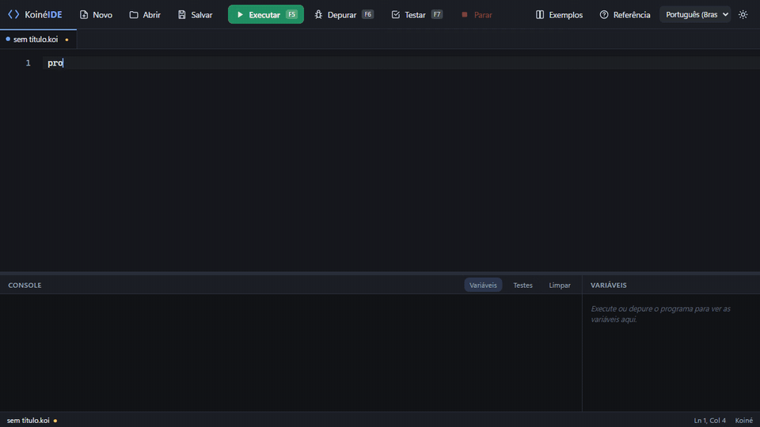
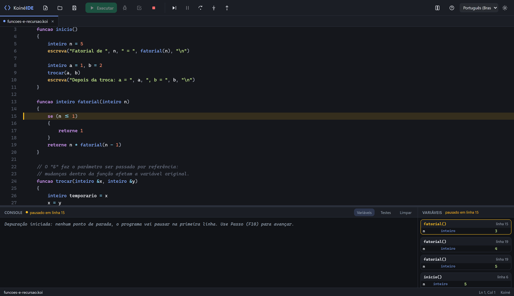
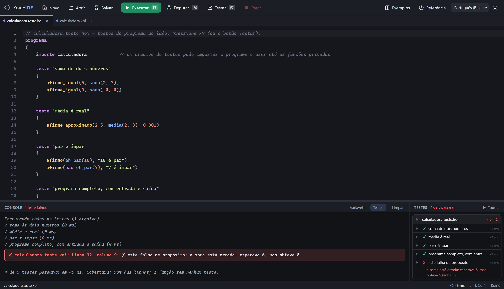
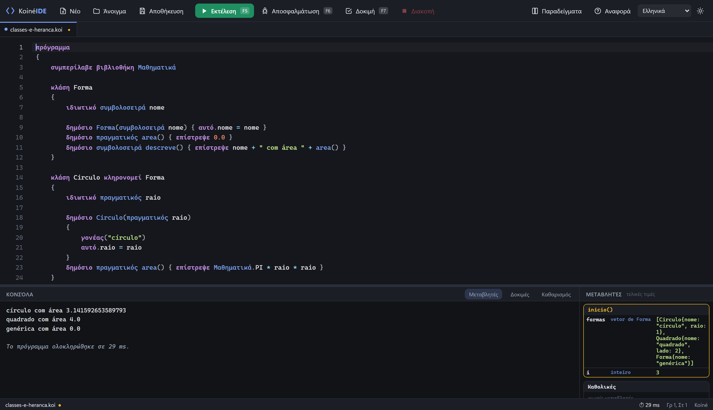

# Koiné IDE

[](https://github.com/6a8i/koine-ide/actions/workflows/ci.yml)
[](https://github.com/6a8i/koine-ide/releases/latest)
[](https://6a8i.github.io/koine-ide/)
[](LICENSE)

IDE de desktop, leve e gratuita, para aprender programação com **Koiné**, uma linguagem de pseudocódigo escrita **no seu
idioma**. O nome vem do grego *koiné*, a "língua comum": as palavras reservadas, as funções nativas, a interface e a
referência existem em dez idiomas (português, inglês, espanhol, grego, russo, ucraniano, polonês, japonês, coreano e
chinês). Os programas ficam em arquivos `.koi`.

```koine
programa
{
    funcao inicio()
    {
        escreva("Olá, mundo!\n")
    }
}
```



Em um minuto: [vídeo de primeiro uso](https://6a8i.github.io/koine-ide/#video) (escrever, executar, corrigir um erro,
depurar, testar e trocar o idioma).

**Site e documentação completa: <https://6a8i.github.io/koine-ide/>** (guia da IDE, tour pela linguagem, referência,
exemplos e a tabela dos dez idiomas).

## Download e instalação

Baixe o arquivo do seu sistema na página de [**Releases**](https://github.com/6a8i/koine-ide/releases/latest). Nenhum
pede senha de administrador, e todos são gerados automaticamente pelo GitHub Actions a partir do código.

| Sistema | Arquivo | Como instalar |
| --- | --- | --- |
| Windows 10/11 (64 bits) | `Koine.IDE_x.y.z_x64-setup.exe` (ou `.msi`) | Execute. O SmartScreen pode avisar "editor desconhecido": *Mais informações* → *Executar assim mesmo*. |
| Linux (x86-64) | `koine-ide_x.y.z_amd64.AppImage` | `chmod +x` e execute; precisa do WebKitGTK 4.1 (Ubuntu 22.04+, Debian 12+, Fedora 36+). |
| Debian/Ubuntu/Mint | `koine-ide_x.y.z_amd64.deb` | `sudo apt install ./koine-ide_x.y.z_amd64.deb`; registra o menu e a extensão `.koi`. |
| macOS 11+ (Intel e Apple Silicon) | `Koine.IDE_x.y.z_universal.dmg` | Arraste para Aplicativos; na primeira vez, botão direito → *Abrir* (o app não é notarizado). |

Depois de instalado, arquivos `.koi` abrem com duplo clique. Passo a passo no
[guia de instalação](https://6a8i.github.io/koine-ide/guia.html#instalar).

## Como usar

O [guia da IDE](https://6a8i.github.io/koine-ide/guia.html) explica tudo em detalhe; este é o resumo.

### Escrever e executar

Novo programa (`Ctrl+N`), escreva, **F5**. A saída aparece no console; `leia(...)` abre uma linha de entrada ali mesmo.
**Parar** (`Shift+F5`) interrompe um programa que não termina. Erros aparecem com linha e coluna, marcados no editor, e a
mensagem diz como corrigir (ex.: *"A condição do 'se' usa '=' (atribuição). Para comparar valores use '=='"*).
O menu **Exemplos** traz programas prontos e **Referência** (`F1`) explica cada palavra e função, com exemplo para
inserir no editor.

### Depurar

Clique na margem para marcar um ponto de parada e pressione **F6**. `F10` passo, `F11` entra na função, `Shift+F11` sai,
`F8` continua. O painel **Variáveis** mostra a pilha de chamadas e o valor de cada variável ao vivo; passe o mouse sobre
uma variável no editor para ver o valor.



### Testar

Escreva blocos `teste "nome" { ... }` com `afirme`, `afirme_igual`, `afirme_aproximado`, `entrada(...)` e `saida()`, no
próprio programa ou num arquivo que o importa, e pressione **F7**. O painel **Testes** mostra o que passou e falhou e a
**cobertura**: linhas executadas por arquivo, funções sem teste e marcas verde/vermelho no editor.



### Projetos com vários arquivos

**Pasta** (`Ctrl+Shift+O`) abre uma pasta como projeto, com árvore de arquivos à esquerda. **F5** executa o projeto
inteiro a partir do arquivo principal (fixe um na barra de status ou deixe a IDE escolher). Um arquivo sem
`funcao inicio()` é um módulo: `importe Nome` traz o que ele declarou `publico`.

### Idiomas

O seletor na barra troca o idioma da interface e das palavras reservadas; ao trocar, a IDE oferece converter os
arquivos abertos (só palavras reservadas e funções nativas; textos, comentários e nomes do usuário ficam como estão).
As palavras em português continuam valendo em qualquer idioma.



## Funcionalidades

- **Linguagem**: tipos, funções (com passagem por referência), vetores e matrizes, quatro bibliotecas
  (`Matematica`, `Texto`, `Util`, `Tipos`), estruturas, classes com herança, referências seguras, módulos com
  visibilidade `publico`/`privado` e testes. Tour completo em [A linguagem](https://6a8i.github.io/koine-ide/linguagem.html).
- **Editor**: destaque de sintaxe, autocompletar, dobra de blocos, busca, múltiplos cursores, dicas ao passar o mouse.
- **Execução** em segundo plano (a janela nunca trava), console com entrada inline, tempo de execução.
- **Verificação de tipos** antes de executar e mensagens de erro didáticas.
- **Depurador** com pontos de parada, passo a passo, pilha de chamadas e variáveis ao vivo.
- **Testes e cobertura** escritos na própria linguagem.
- **Projetos em pasta**, módulos e arquivo principal automático; erros abrem o arquivo certo.
- **Dez idiomas** com conversão do código; tema claro/escuro; exemplos prontos.

## Desenvolvimento

Pré-requisitos (Windows; no Linux instale as dependências do Tauri com `apt`, como no workflow de release; no macOS, as Xcode Command Line Tools):

1. **Node.js 18+** — <https://nodejs.org>
2. **Rust** — <https://rustup.rs> (instala o `cargo`)
3. **Microsoft C++ Build Tools** — <https://visualstudio.microsoft.com/visual-cpp-build-tools/>
   (marque "Desenvolvimento para desktop com C++"). O WebView2 já vem no Windows 10/11.

```bash
npm install          # dependências do frontend
npm run tauri dev    # abre a janela em modo de desenvolvimento (recarrega ao salvar)
npm run tauri build  # gera o instalador em src-tauri/target/release/bundle/
```

Outros comandos:

```bash
npm test                                  # testes do interpretador + validador de idiomas (node)
npm run dev                               # só o frontend, no navegador (http://localhost:1420)
npm run build                             # compila o frontend para dist/
node --import tsx scripts/build-docs.ts   # gera referência/exemplos/idiomas do site (docs/)
node scripts/screenshots.mjs              # refaz as capturas de tela de docs/img (precisa do npm run dev)
```

> A primeira compilação do Rust demora alguns minutos; as seguintes são rápidas.

## Estrutura

```
src/
  lang/
    shared/      lexer, tipos, runtime comum, ligador de módulos, testes/cobertura, depurador (debug.ts)
    koine/       a linguagem: parser → resolver (tipos/escopos) → interpretador
    i18n/        vocabulário por idioma (palavras reservadas e funções nativas) e conversor de código
    worker.ts    executa o programa fora da thread da interface
  ui/            editor (CodeMirror), console, variáveis, testes, referência, arquivos (Tauri), destaque de sintaxe
  i18n/          textos da interface por idioma
  examples/      programas de exemplo
  reference/     conteúdo da referência (palavras reservadas e funções) e suas traduções
  main.ts        monta a aplicação
src-tauri/       aplicação nativa (Rust): janela, diálogos, leitura/escrita de arquivos
tests/           casos de teste do interpretador (run.ts) e validador das tabelas de idioma (check-i18n.ts)
docs/            site de documentação (GitHub Pages); referência, exemplos e idiomas são gerados do código
scripts/         geração das páginas da documentação e das capturas de tela
.github/         CI (PRs), release (instalador), pages (site), modelos de issue/PR
```

## Como funciona por dentro

**Interpretador.** O código é analisado para uma árvore (AST) com tipos já resolvidos e variáveis mapeadas para posições
fixas (slots), o que torna a execução rápida (milhões de operações por segundo). Comandos que precisam esperar o usuário
(`leia`, `Util.aguarde`) são marcados na análise; só esses trechos são executados de forma assíncrona — todo o resto roda
de forma síncrona. Num projeto, cada arquivo é analisado separadamente; o ligador (`src/lang/shared/modules.ts`) resolve
os `importe`, detecta ciclos e ordena os módulos, e o resolvedor verifica tipos e visibilidade com os módulos importados.

**Depurador.** No modo de depuração a árvore inteira é marcada como assíncrona e, antes de cada comando, o interpretador
chama o depurador (`src/lang/shared/debug.ts`), que decide se pausa e envia uma "foto" das variáveis para a interface.
A execução normal não paga nada por isso.

**Idiomas.** O vocabulário interno é o português: cada idioma tem uma tabela canônico → palavra localizada
(`src/lang/i18n/vocab/*.ts`). O lexer traduz as palavras do idioma ativo para o canônico antes da análise, então parser
e interpretador não mudam; `verdadeiro`/`falso` são escritos e lidos no idioma. O conversor (`translateSource`) troca só
os tokens de vocabulário, preservando textos e comentários. Os textos da interface usam o português como chave
(`src/i18n/ui/*.ts`) e os resumos da referência ficam em `src/reference/i18n/*.ts`. `npm test` valida as tabelas.
As mensagens de erro do compilador e do interpretador também são traduzidas: o código usa `m("texto em português")`
(`src/lang/i18n/messages.ts`) e cada idioma tem um dicionário em `src/lang/i18n/messages/*.ts`; os comentários e textos dos
exemplos têm o seu em `src/examples/i18n/*.ts`. O validador confere que nenhuma mensagem ficou sem tradução e que os
parâmetros `{x}` batem.

## Contribuindo

Contribuições são bem-vindas: bugs, ideias, código, exemplos e traduções. Leia o [guia de contribuição](CONTRIBUTING.md)
(ambiente, testes, regras para mudanças na linguagem e nos idiomas, fluxo de PR) e o
[Código de Conduta](CODE_OF_CONDUCT.md). Vulnerabilidades: veja a [política de segurança](SECURITY.md) e use o relato
privado. A `main` só recebe mudanças por pull request com commits assinados; toda PR passa pela integração contínua (testes do interpretador, validador
de idiomas, build do frontend, `cargo fmt`/`clippy`); as versões são publicadas automaticamente a partir de uma tag
`vX.Y.Z`, com o instalador do Windows anexado à release, e o site é republicado a cada mudança na `main`.

## Licença

[MIT](LICENSE)
